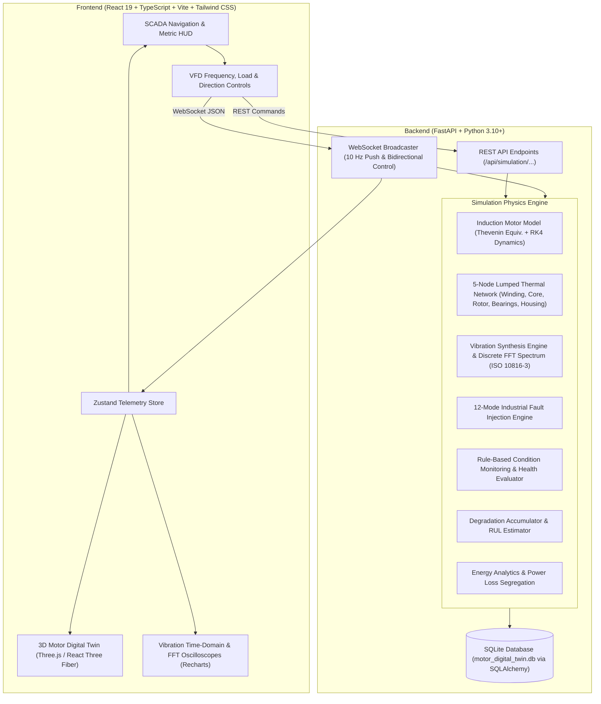

# Intelligent Electric Motor Digital Twin, Real-Time Condition Monitoring and Predictive Maintenance System

[](https://fastapi.tiangolo.com)
[](https://react.dev)
[](https://threejs.org)
[](https://python.org)
[](https://www.typescriptlang.org)
[](https://tailwindcss.com)
[](LICENSE)

> **DISCLAIMER:**  
> This software is an educational and engineering simulation platform. It is not a certified motor protection, industrial control, or safety-critical system. All telemetry, diagnostic indications, and Remaining Useful Life (RUL) projections are algorithmically simulated values.

---

## 1. Project Title & Overview

The **Intelligent Electric Motor Digital Twin, Real-Time Condition Monitoring and Predictive Maintenance System** is a software-only digital twin platform simulating an industrial 5.5 kW, 415 V, 4-pole three-phase squirrel-cage induction motor (SCIM).

Designed for university engineering evaluations, GitHub portfolio presentation, and industrial IoT technical demonstrations, this platform connects mathematical electromechanical equations with an industrial SCADA-style dark UI, a 3D digital twin canvas powered by Three.js / React Three Fiber, real-time vibration spectral FFT analysis, a 12-mode fault injection engine, and predictive degradation tracking.

No physical motors, microcontrollers (ESP32/Arduino/Raspberry Pi), or paid cloud subscriptions are required. The entire stack executes locally on Windows, macOS, or Linux.

---

## 2. Problem Statement

In heavy process industries (mining, petrochemical, manufacturing, utilities), electric induction motors account for over **70% of all industrial electrical energy consumption**. Unplanned motor breakdowns lead to costly factory downtime, safety hazards, and energy waste. Traditional maintenance operates on reactive ("run-to-failure") or rigid calendar-based schedules.

Physical testing of hazardous motor operating conditions (e.g., severe single-phasing, locked rotor, thermal insulation runaway, acute bearing spalling) is prohibitively dangerous, destructive, and expensive in educational and research environments. A high-fidelity, interactive, physics-grounded Digital Twin enables operators, engineers, and students to safely observe machine electrodynamics, evaluate failure modes, and test predictive maintenance algorithms in real time.

---

## 3. Project Objectives

- **Electromechanical Realism**: Implement steady-state Thevenin equivalent circuits and dynamic differential equations ($J \frac{d\omega}{dt} = T_e - T_L - B\omega$) solved via 4th-Order Runge-Kutta (RK4).
- **Synchronized 3D Visualization**: Render an interactive 10-component 3D motor whose rotation speed and direction dynamically track backend RPM, with real-time fault visual highlighting.
- **Vibration & Spectral Diagnostics**: Synthesize radial vibration waveforms ($v(t)$ in mm/s) incorporating 1X imbalance, 2X misalignment, bearing pass harmonics (BPFO/BPFI), 2fe electrical vibration, and compute real-time discrete FFT spectra classified against ISO 10816-3 severity zones.
- **Fault Injection Studio**: Provide 12 selectable industrial fault modes with adjustable severities (0.0 to 1.0) and deterministic random seeds.
- **Predictive Health & RUL**: Track multi-stress degradation (thermal, vibrational, overload) to compute machine health scores and estimate Remaining Useful Life (RUL).
- **Energy Analytics & Loss Segregation**: Segregate motor losses (stator copper, rotor copper, core iron, friction/windage, stray load), integrate kWh, and compare operating scenarios.

---

## 4. System Architecture



---

## 5. Technology Stack

| Layer | Technologies | Purpose |
| :--- | :--- | :--- |
| **Frontend** | React 19, TypeScript, Vite, Tailwind CSS | High-performance industrial dashboard UI |
| **3D Graphics** | Three.js, React Three Fiber (`@react-three/fiber`), Drei | Real-time 3D motor geometry and dynamic rotation |
| **Charts** | Recharts, Lucide React | Oscilloscopes, FFT spectrum, thermal trends |
| **State** | Zustand | Real-time 10 Hz WebSocket telemetry state |
| **Backend** | Python 3.10+, FastAPI, Pydantic v2 | High-throughput async REST and WebSocket APIs |
| **Simulation** | NumPy, SciPy | RK4 dynamics solver, FFT, thermal network |
| **Database** | SQLite, SQLAlchemy 2.0 ORM | Historical telemetry, alerts, and maintenance logs |
| **Testing** | Pytest, FastAPI TestClient | 26 automated unit and integration tests |

---

## 6. Mathematical Induction Motor Simulation Engine

### A. Kinematics & Slip
$$N_s = \frac{120 \cdot f}{P} \quad [\text{RPM}], \quad s = \frac{N_s - N_r}{N_s}$$

### B. Thevenin Equivalent Circuit & Developed Torque
$$V_{th} = V_1 \cdot \frac{X_m}{\sqrt{R_1^2 + (X_1 + X_m)^2}}, \quad Z_{th} = R_{th} + j X_{th}$$
$$T_e(s) = \frac{3}{\omega_s} \cdot \frac{V_{th}^2 \cdot \frac{R_2'}{s}}{\left(R_{th} + \frac{R_2'}{s}\right)^2 + (X_{th} + X_2')^2} \quad [\text{N}\cdot\text{m}]$$

### C. Mechanical Dynamics (RK4 Solver)
$$J \frac{d\omega_m}{dt} = T_e(\omega_m) - T_L - B \omega_m$$
Integrated using 4th-Order Runge-Kutta with internal sub-stepping ($h \le 0.005$ s) for unconditional numerical stability across rapid speed reversals and locked-rotor shocks.

### D. Three-Phase Electrical Calculations
- **Active Power**: $P = \sqrt{3} \cdot V_{LL} \cdot I_L \cdot \cos\phi$
- **Reactive Power**: $Q = \sqrt{3} \cdot V_{LL} \cdot I_L \cdot \sin\phi$
- **Apparent Power**: $S = \sqrt{3} \cdot V_{LL} \cdot I_L$
- **Efficiency**: $\eta = (P_{mech} / P_{in}) \times 100\%$

---

## 7. 5-Node Lumped Parameter Thermal Network

The motor thermal response models heat transfer between five distinct physical nodes:
1. **Stator Winding ($T_w$)**: Stator copper loss ($3 I_1^2 R_1(T)$).
2. **Stator Core ($T_s$)**: Core iron losses ($P_{core}$).
3. **Rotor Core & Cage ($T_r$)**: Rotor copper losses ($s \cdot P_{airgap}$).
4. **Bearings ($T_b$)**: Mechanical friction and bearing wear dissipation.
5. **Motor Housing ($T_h$)**: Dissipation to ambient air ($T_{amb}$).

### Forced Convection Cooling:
$$R_{h-a}(\omega_m) = \frac{R_{base}}{1 + 3.2 \cdot k_{fan} \cdot \left(\frac{\omega_m}{\omega_{rated}}\right)^{0.8}}$$
If cooling fan failure is triggered, convective airflow collapses by 95%, causing rapid thermal escalation.

---

## 8. Vibration Synthesis & Spectral FFT Analysis

Synthesizes radial vibration velocity waveforms ($v(t)$ mm/s) sampled at 2048 Hz:
- **1X ($f_r = N_r / 60$)**: Rotor unbalance ($A_{1X} \propto m_{ecc} \cdot \omega_m^2$).
- **2X ($2 f_r$)**: Angular and parallel shaft misalignment.
- **2fe ($100 \text{ Hz}$)**: Electrical double-line-frequency vibration.
- **Bearing Frequencies (6206 Deep Groove Ball Bearing)**:
  - $\text{BPFO} \approx 3.57 \times f_r$ (Ball Pass Frequency Outer Race)
  - $\text{BPFI} \approx 5.43 \times f_r$ (Ball Pass Frequency Inner Race)
  - $\text{BSF} \approx 2.32 \times f_r$ (Ball Spin Frequency)
  - $\text{FTF} \approx 0.397 \times f_r$ (Fundamental Train Frequency)

Evaluated against **ISO 10816-3 Severity Standards**:
- **Zone A ($< 1.4 \text{ mm/s}$)**: Good (newly commissioned).
- **Zone B ($1.4 - 2.8 \text{ mm/s}$)**: Acceptable for unrestricted continuous operation.
- **Zone C ($2.8 - 4.5 \text{ mm/s}$)**: Unsatisfactory (warning alert; schedule service).
- **Zone D ($> 4.5 \text{ mm/s}$)**: Unacceptable (critical danger; stop machine).

---

## 9. 12-Mode Industrial Fault Injection Matrix

| # | Fault Mode | Affected Component | Impact on Simulation |
| :--- | :--- | :--- | :--- |
| 1 | **Bearing Wear** | Bearings | High BPFO/BPFI sidebands, elevated bearing friction heat ($+180\text{W}$) |
| 2 | **Rotor Imbalance** | Rotor | Massive 1X vibration surge ($> 4\text{ mm/s}$ RMS) |
| 3 | **Shaft Misalignment** | Shaft & Coupling | Dominant 2X rotational harmonic peak |
| 4 | **Motor Overload** | Stator & Rotor | Load torque set to 110%–160%, elevated slip, thermal warning |
| 5 | **Cooling Fan Failure**| Cooling Fan | Airflow factor drops by 95%, rapid temperature rise |
| 6 | **Winding Overheating**| Stator Winding | Stator resistance $R_1$ rises by 40%, elevated $I^2R$ losses |
| 7 | **Voltage Imbalance** | Terminal Box | Negative sequence current, 2fe electrical vibration (100 Hz) |
| 8 | **Phase Loss** | Terminal Box | Single-phasing ($V_c = 0$), remaining phase currents surge to 173% |
| 9 | **Supply Under-Voltage**| Terminal Box | Line voltage drops by 15%–30%, higher current draw to maintain load |
| 10 | **Supply Over-Voltage** | Terminal Box | Line voltage increases by 10%–25%, core magnetic saturation |
| 11 | **Excessive Vibration** | Mounting Base | Structural looseness, sub-harmonics, ISO Zone D alert |
| 12 | **Mechanical Blockage** | Shaft & Rotor | Locked rotor, speed drops to 0, locked-rotor inrush current |

---

## 10. Installation & Quick Startup

### Prerequisites
- **Python**: 3.10+ (tested on Python 3.10, 3.11, 3.12, 3.14)
- **Node.js**: 18+ (with npm)

### Option A: One-Click Startup (Windows)
Double-click `start.bat` in the repository root. This script verifies the environment and automatically launches both the FastAPI backend and the Vite frontend.

### Option B: Manual Startup

#### 1. Backend Setup:
```bash
cd backend
python -m pip install -r requirements.txt
python -m uvicorn app.main:app --host 0.0.0.0 --port 8000 --reload
```

#### 2. Frontend Setup:
```bash
cd frontend
npm install --legacy-peer-deps
npm run dev
```

Open your browser at **`http://localhost:5173`**.

---

## 11. Automated Test Suite

Run the 26 automated unit and physics verification tests:

```bash
cd motor-digital-twin
python -m pytest tests/backend -v
```

### Test Coverage Highlights:
- Kinematic calculations ($N_s, s, \omega_m$)
- Torque-speed curve generation
- RK4 mechanical acceleration and braking dynamics
- 3-phase electrical power balance and loss segregation
- 5-node thermal network rise and decay
- Vibration waveform synthesis and discrete FFT
- All 12 fault injection triggers and parameter modifiers
- REST API schemas, WebSocket streaming, and CSV export

---

## 12. License & Evaluation Notice

This project is released under the **MIT License**. Created for academic evaluation, GitHub portfolio display, and engineering demonstrations.
